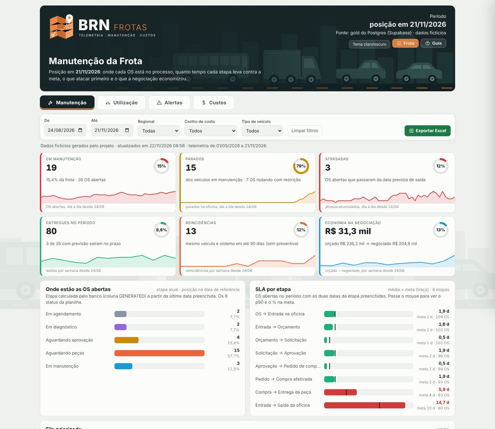
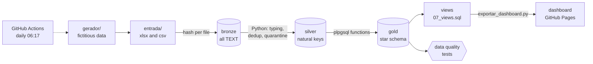
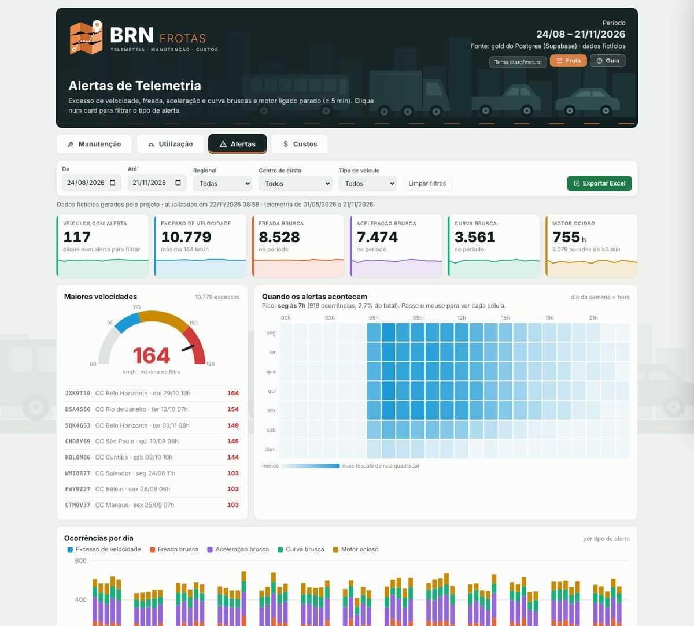
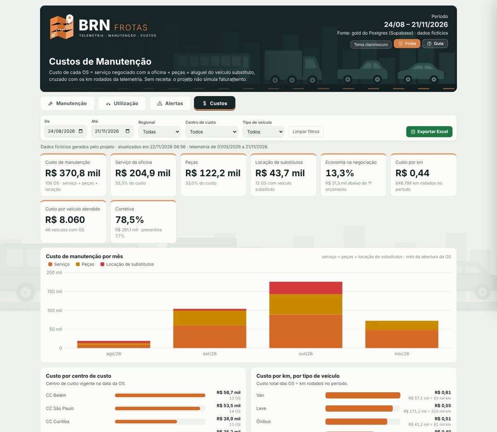
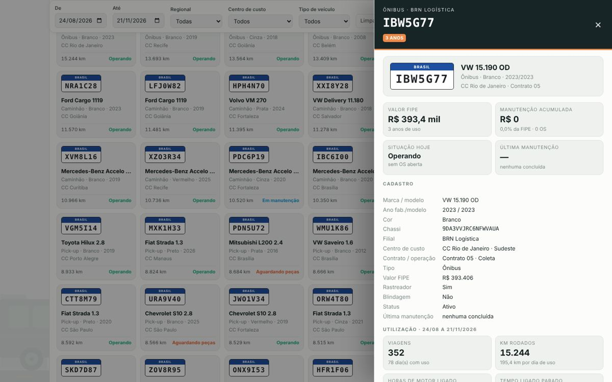

# brn-frota-data-platform

**A fleet data platform that joins vehicle telemetry and maintenance:** Python ETL, a Postgres database (Supabase) in bronze → silver → gold layers, business rules in SQL, data quality tests and a dashboard that refreshes itself every day.

🇧🇷 [Versão em português](README.md) · 📊 **[Open the dashboard](https://brunolima-085.github.io/brn-frota-data-platform/)** (in Portuguese)

> **100% fictitious data.** License plates, VINs, models, drivers, repair shops and amounts are generated by a seeded script. Only the cities are real. The project reproduces problems found in real fleet management without using any company's data.



---

## The problem

A fleet with GPS trackers and outsourced repair shops produces two sources that don't talk to each other:

- **the tracker** exports trip and alert spreadsheets (speeding, harsh braking, engine idling…) in overlapping windows, with duplicated rows, alerts that arrive "open" and close in the next file, blank drivers filled in later, and physically impossible readings;
- **the maintenance tracking spreadsheet** is typed by hand: dates and amounts as text, odometer in three formats, picklists without accents, part requisition numbers written several ways, plates that don't exist in the fleet.

Without treatment, the questions that matter go unanswered: *which vehicles are off the road and at which stage? which stage is the bottleneck? how much does a stopped vehicle cost, including the rental replacement? do harsher drivers cost more at the shop?*

## What it does

Every day at 06:17 (UTC−3), GitHub Actions:

1. **generates the "new day"** of the simulation: yesterday's tracker files and the updated maintenance sheet (work orders move forward, new ones appear). The past never changes;
2. **loads only new files into bronze** (SHA-256 hash of each file's content);
3. **cleans into silver**: typing, deduplication, merging of record versions, standardization, quarantine and outlier review;
4. **builds the gold star schema** with SQL functions;
5. **runs 15 cross-layer data quality tests**; a failing critical test fails the run;
6. **applies bronze retention** (90 days), commits the weekly summary and run status;
7. **exports the gold views** and **publishes the dashboard** to GitHub Pages.



## Layers

| Layer | Where | What it holds | Techniques |
|---|---|---|---|
| **bronze** | `banco/01_bronze.sql` · `pipeline/carregar_bronze.py` | the file as received, all `TEXT`, one batch per file | content SHA-256 with `UNIQUE (source, hash)`, bulk `COPY`, retention function |
| **silver** | `banco/02_silver.sql` · `pipeline/*/tratar_*.py` | typed, clean data, one row per natural key | upsert `ON CONFLICT … WHERE (…) IS DISTINCT FROM (…)`, `RETURNING (xmax = 0)` to count inserts × updates, JSONB quarantine |
| **gold** | `banco/03_gold.sql` · `banco/04_carga_gold.sql` | dimensions and facts | `plpgsql` functions, `GENERATED ALWAYS AS … STORED` columns, `EXCLUDE USING gist` against overlapping allocations, domain `CHECK`s, `dim_data` via `generate_series` with holidays |
| **views** | `banco/07_views.sql` | dashboard metrics | `LAG()` for repeat repairs, `PERCENTILE_CONT` for SLA, `CORR()`, `DISTINCT ON`, `generate_series` for idle days, regex to group addresses, `security_invoker` |

## Planted problems and how they are handled

The generator plants real-world problems on purpose and writes an answer key the pipeline never reads. Pipeline counts match the answer key.

| Problem at the source | Handling |
|---|---|
| same alert/trip in two files (overlapping windows) | merged by key (`plate + rule + timestamp`), the most complete version wins |
| alert "open" that closes in the next file | updated in silver, never duplicated |
| blank driver filled in later | "fill" mode: a blank never overwrites a value |
| duplicated rows and footer rows (TOTAL, AVERAGE) | dropped and counted in the log |
| impossible trip (negative distance, > 200 km/h, > 100 km/L) | sent to a review spreadsheet; reaches gold only if approved |
| speed ≥ 150 km/h with no odometer change | outlier; confirmed by the odometer, it is kept |
| dates/amounts typed as text, odometer as `85320`, `"85.320"`, `"85320 km"` | converted, each case counted |
| picklists without accents and mixed case | matched against the valid list ignoring accents and case |
| requisition numbers like `req 26 0031`, `REQ260031` | regex to `REQ-26-0031` |
| work order with a plate not in the fleet | **quarantined** with the reason, never silently dropped |
| "Replacement vehicle = Yes" with no plate | flagged by a quality test |

## Business rules computed in the database

No dashboard number comes ready-made from the spreadsheet: the database computes it, so everyone gets the same result.

- **Work order stage** from the last filled date (6 statuses) and **days in each of the 8 SLA stages** (`GENERATED` columns).
- **Discount obtained** = quote − negotiated amount.
- **Cost of a stopped vehicle** = negotiated service + parts + replacement rental (daily rate × days stopped, or the fixed period fee).
- **Repeat repair**: same vehicle and system within 90 days (`LAG`), preventive excluded.
- **Cost center in force on the date** of each trip and work order.
- **Reference date** = last day with telemetry, so numbers are reproducible.

## Data quality

`gold.testes_qualidade()` returns one row per test. Critical tests fail the pipeline (non-zero exit code); warnings go to the report: row conservation between layers, referential integrity, no unprocessed batches, physically possible values, plus warnings for out-of-order dates, negotiated above quote, replacement without plate, typed status ≠ status by dates, pending outliers and quarantined orders. Plus 59 unit tests (`pytest`).

## Engineering decisions

- **Idempotent:** running twice changes nothing (`--testar-idempotencia` proves it).
- **Stable "new day":** every day/vehicle/work order has its own seed; past files keep the same hash and work order numbers never shift.
- **Content hash, not file hash:** the same .xlsx saved on Windows and on Linux has different bytes; hashing the cell values means the same data is never loaded twice, whatever machine produced the file.
- **Quarantine instead of dropping**, and **human review of outliers** fed back into the pipeline.
- **Resilient connection:** up to 4 connection attempts with backoff, and a stage is retried once if the connection drops; safe because stages are idempotent.
- **Security:** RLS on every table; credentials only in the local `.env` and a GitHub secret.
- **Zero cost:** Supabase free tier + GitHub Actions + GitHub Pages. The daily run also keeps the free Supabase project from pausing.

## Dashboard

Static HTML (no framework) fed by the gold views: **Maintenance, Usage, Alerts and Costs** tabs; filters by period, region, cost center and vehicle type; Brazil map; vehicle sheet on plate click; full fleet table; user guide; Excel export; light/dark theme; mobile-friendly.

| | |
|---|---|
|  |  |
|  | |

## Run it locally

Python 3.12+ and a [Supabase](https://supabase.com) project (free tier is enough).

```bash
pip install -r requirements.txt
cp .env.exemplo .env          # fill in SUPABASE_DB_URL (Session pooler)
```

Run the files in `banco/` in order (`01` to `07`) in the Supabase SQL Editor, then:

```bash
python rodar_pipeline.py --gerar-dados             # generate up to yesterday and run everything
python rodar_pipeline.py --etapas testes,dashboard # selected stages only
python -m pytest -q                                # unit tests
```

Open `dashboard/index.html` in a browser.

## Known limits and next steps

- The Supabase free tier has 500 MB; at ~0.6 MB/day (silver + gold) it lasts about a year before silver also needs retention.
- Next: local environment with Docker, gold transformations in dbt, orchestration with Airflow.

---

Built by **Bruno Lima** · [github.com/BrunoLima-085](https://github.com/BrunoLima-085)
