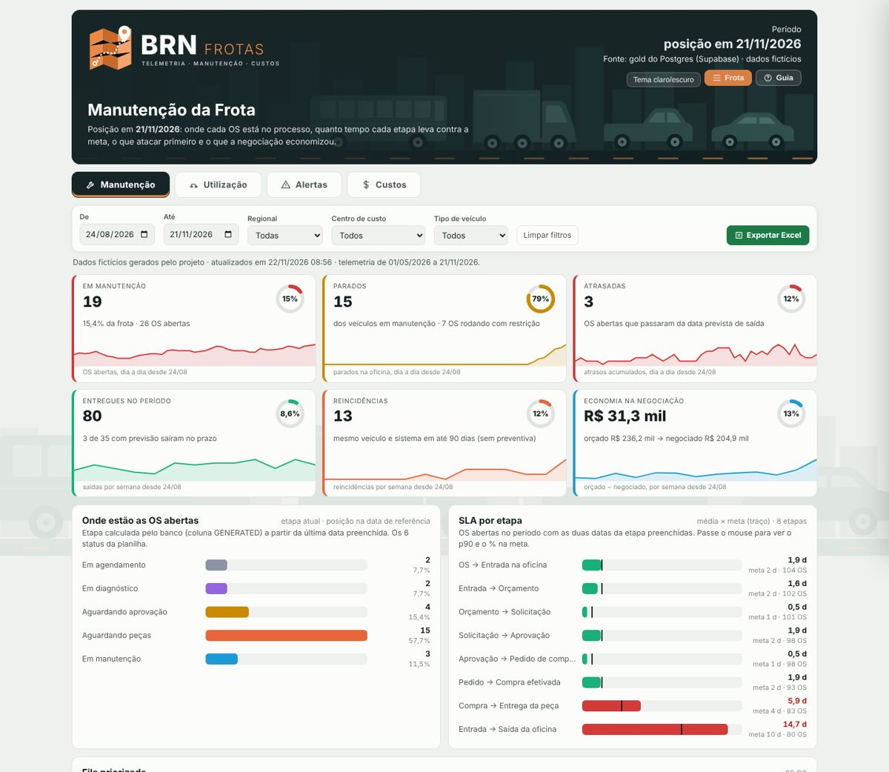
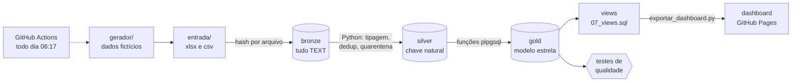
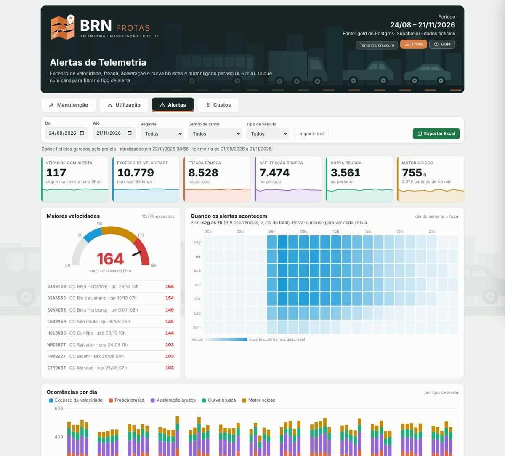
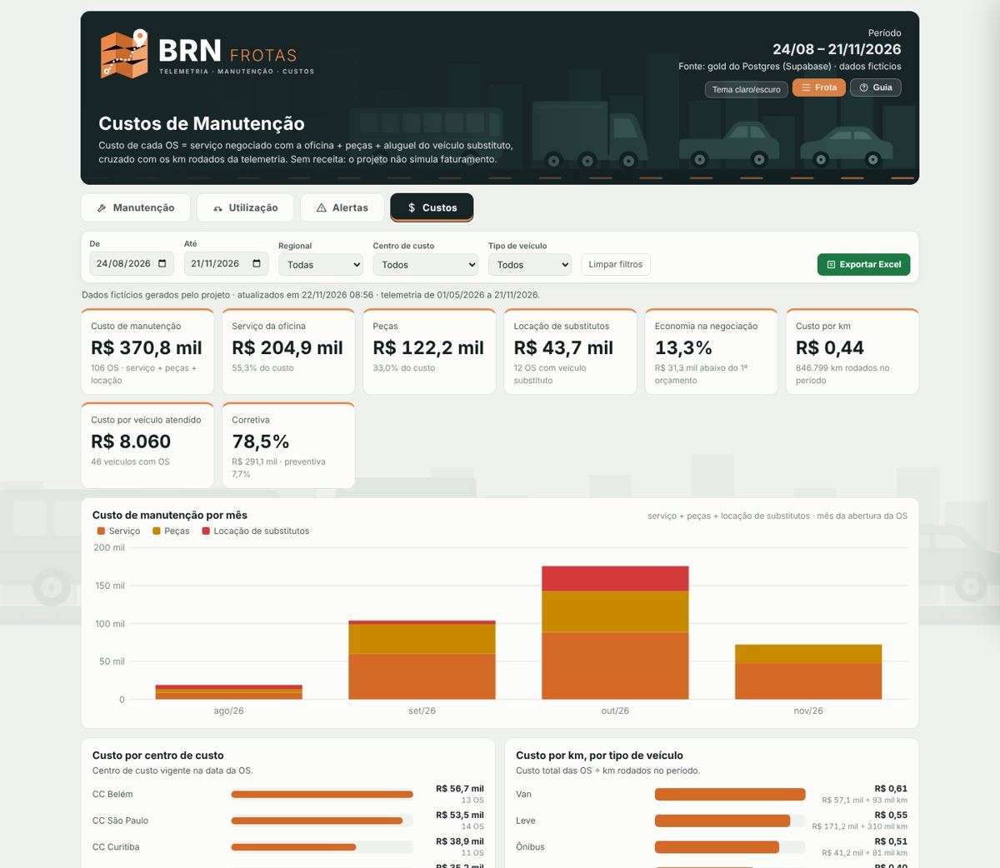
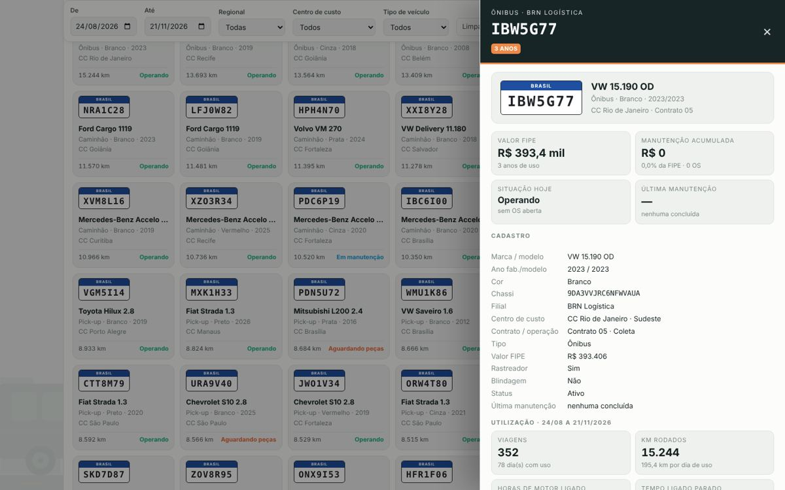

# brn-frota-data-platform

**Plataforma de dados de frota que cruza telemetria e manutenção:** pipeline ETL em Python, banco Postgres (Supabase) em camadas bronze → silver → gold, regras de negócio em SQL, testes de qualidade e um dashboard que se atualiza sozinho todo dia.

🇬🇧 [English version](README.en.md) · 📊 **[Abrir o dashboard](https://brunolima-085.github.io/brn-frota-data-platform/)**

> **Dados 100% fictícios.** Placas, chassis, modelos, motoristas, oficinas e valores são gerados por script com semente fixa. Só as cidades são reais. O projeto reproduz problemas que acontecem na gestão de uma frota de verdade, sem usar dado de nenhuma empresa.



---

## O problema

Uma frota com rastreador e oficina terceirizada gera duas fontes que não conversam:

- **o rastreador** exporta planilhas de viagens e alertas (excesso de velocidade, freada brusca, motor ligado parado…) em janelas que se sobrepõem, com linhas repetidas, alertas que chegam "em aberto" e fecham no arquivo seguinte, motorista vazio que aparece preenchido depois e leituras fisicamente impossíveis;
- **a planilha de acompanhamento de manutenção** é digitada à mão: datas e valores como texto, KM em três formatos, listas sem acento, nº de requisição escrito de vários jeitos, placa que não existe na frota.

Sem tratamento, as perguntas que importam ficam sem resposta: *quais veículos estão parados e em que etapa? qual etapa atrasa mais? quanto custa um veículo parado, contando o aluguel do substituto? quem dirige pior gasta mais com oficina?*

## O que o projeto faz

Todo dia, às 06:17 (Fortaleza), o GitHub Actions:

1. **gera o "dia novo"** da simulação: os arquivos de ontem do rastreador e a planilha de manutenção atualizada (as OS avançam de etapa, surgem OS novas). O passado nunca muda;
2. **carrega na bronze** só os arquivos novos (hash SHA-256 do conteúdo de cada arquivo);
3. **trata na silver**: tipagem, deduplicação, consolidação de versões, padronização, quarentena e separação de outliers para revisão;
4. **monta a gold** (modelo estrela) com funções em SQL;
5. **roda 15 testes de qualidade** entre as camadas; teste crítico falhando derruba a execução;
6. **aplica a retenção** da bronze (90 dias), grava o resumo semanal e o status no repositório;
7. **exporta as views** da gold e **publica o dashboard** no GitHub Pages.



## Arquitetura em camadas

| Camada | Onde | O que guarda | Técnicas |
|---|---|---|---|
| **bronze** | `banco/01_bronze.sql` · `pipeline/carregar_bronze.py` | o arquivo como veio, tudo `TEXT`, um lote por arquivo | hash SHA-256 do conteúdo com `UNIQUE (fonte, hash)`, `COPY` em massa, retenção por função |
| **silver** | `banco/02_silver.sql` · `pipeline/*/tratar_*.py` | dado tipado e limpo, uma linha por chave natural | upsert `ON CONFLICT … WHERE (…) IS DISTINCT FROM (…)`, `RETURNING (xmax = 0)` para contar novos × atualizados, quarentena em JSONB |
| **gold** | `banco/03_gold.sql` · `banco/04_carga_gold.sql` | dimensões e fatos para análise | funções `plpgsql`, colunas `GENERATED ALWAYS AS … STORED`, `EXCLUDE USING gist` contra alocação sobreposta, `CHECK`s de domínio, `dim_data` com `generate_series` e feriados |
| **views** | `banco/07_views.sql` | indicadores do dashboard | `LAG()` para reincidência, `PERCENTILE_CONT` no SLA, `CORR()`, `DISTINCT ON`, `generate_series` para dias sem uso, regex para agrupar endereços, `security_invoker` |

## Problemas plantados e como são tratados

O gerador planta problemas reais de propósito e grava um gabarito à parte (que o pipeline não lê). As contagens do pipeline batem com o gabarito.

| Problema na origem | Tratamento |
|---|---|
| mesmo alerta/viagem em dois arquivos (janelas sobrepostas) | consolidação por chave (`placa + regra + data/hora`), a versão mais completa vence |
| alerta "em aberto" que fecha no arquivo seguinte | atualização na silver, nunca linha duplicada |
| motorista vazio que aparece preenchido depois | modo "completar": o vazio não apaga o preenchido |
| linha repetida dentro do arquivo e linhas de rodapé (TOTAL, MÉDIA) | descartadas e contadas no log |
| viagem impossível (distância negativa, > 200 km/h, > 100 km/L) | vai para `saida/outliers_para_revisao.xlsx`; só entra na gold se for aprovada |
| velocidade ≥ 150 km/h sem o odômetro mudar | outlier; com odômetro confirmando, entra |
| datas e valores digitados como texto, KM como `85320`, `"85.320"`, `"85320 km"` | conversão com contagem de cada caso |
| listas sem acento (`Aguardando pecas`, `Suspencao`) e caixa misturada | padronização contra a lista válida, ignorando acento e caixa |
| nº de requisição como `req 26 0031`, `REQ260031` | regex para `REQ-26-0031` |
| OS com placa que não existe na frota | **quarentena** com o motivo, nunca descarte silencioso |
| "Veículo substituto = Sim" sem a placa | aviso no teste de qualidade |

## Regras de negócio calculadas no banco

Nenhum número do dashboard vem pronto da planilha: o banco calcula, e o resultado é o mesmo para todo mundo.

- **Etapa da OS** pela última data preenchida (6 status) e **dias em cada uma das 8 etapas do SLA** (colunas `GENERATED`).
- **Desconto obtido** = orçamento − negociado.
- **Custo do veículo parado** = serviço negociado + peças + locação do substituto (diária × dias parado, ou o valor fixo do período).
- **Reincidência**: mesmo veículo e mesmo sistema em até 90 dias (`LAG`), sem contar preventiva.
- **Centro de custo vigente na data** de cada viagem e OS (o veículo pode trocar de centro no meio do período).
- **Data de referência** = último dia com telemetria, para os números serem reproduzíveis.

## Qualidade de dados

`gold.testes_qualidade()` devolve uma linha por teste. Os críticos derrubam o pipeline (código de saída ≠ 0); os avisos aparecem no relatório.

- **conservação entre camadas:** fato = silver (menos as regras documentadas);
- **integridade:** nada na silver com placa fora da frota;
- **pipeline em dia:** nenhum lote carregado sem tratamento;
- **valores possíveis:** nenhuma viagem acima de 200 km/h na gold;
- **avisos:** datas do fluxo fora de ordem, valor negociado acima do orçado, substituto sem placa, status digitado diferente da etapa pelas datas, outliers pendentes e OS em quarentena.

Mais 59 testes unitários (`pytest`) para as funções de tratamento.

## Decisões de engenharia

- **Idempotência:** rodar duas vezes não muda nada. `rodar_pipeline.py --testar-idempotencia` prova isso rodando de novo e conferindo que nada foi alterado.
- **"Dia novo" estável:** cada dia, veículo e OS tem semente própria (`rng_de(...)`). Os arquivos de dias passados têm sempre o mesmo hash, e a numeração das OS não muda quando a simulação avança.
- **Hash do conteúdo, não do arquivo:** o mesmo .xlsx salvo no Windows e no Linux tem bytes diferentes; o hash é feito sobre os valores das células, então o mesmo dado nunca entra duas vezes, seja qual for a máquina que gerou o arquivo.
- **Quarentena em vez de descarte:** dado ruim fica guardado com o motivo, para conferência.
- **Revisão humana dos outliers:** a planilha de revisão volta para o pipeline (Aprovado/Rejeitado), e o que é fisicamente impossível não pode ser aprovado.
- **Conexão resiliente:** o pipeline tenta conectar até 4 vezes com espera crescente e repete a etapa uma vez se a conexão cair no meio; como as etapas são idempotentes, repetir é seguro.
- **Segurança:** RLS ligado em todas as tabelas (a API pública não lê nada); credencial só no `.env` local e no *secret* do GitHub.
- **Custo zero:** Supabase gratuito + GitHub Actions + GitHub Pages. A execução diária também impede a pausa do Supabase por inatividade.

## Dashboard

HTML estático (sem framework), alimentado pelas views da gold. Abas **Manutenção, Utilização, Alertas e Custos**; filtros por período, regional, centro de custo e tipo de veículo; mapa do Brasil; ficha do veículo ao clicar na placa; tabela da frota; guia de uso; exportação em Excel; tema claro/escuro; funciona no celular.

| | |
|---|---|
|  |  |
|  | |

## Como rodar localmente

Pré-requisitos: Python 3.12+ e um projeto no [Supabase](https://supabase.com) (o plano gratuito basta).

```bash
pip install -r requirements.txt
cp .env.exemplo .env          # e preencha SUPABASE_DB_URL (Session pooler)
```

No SQL Editor do Supabase, rode os arquivos de `banco/` na ordem (`01` a `07`). Depois:

```bash
python rodar_pipeline.py --gerar-dados             # gera até ontem e roda tudo
python rodar_pipeline.py --etapas testes,dashboard # só algumas etapas
python -m pytest -q                                # testes unitários
```

Abra `dashboard/index.html` no navegador (funciona com duplo clique).

## Estrutura

```
banco/        SQL: tabelas das 3 camadas, funções de carga da gold, testes, retenção e views
gerador/      dados fictícios (frota, telemetria, manutenção) com problemas plantados
pipeline/     ETL em Python: bronze, silver (frota, telemetria, manutenção), gold, testes, resumo, exportação
dashboard/    painel HTML/CSS/JS (dados.js é gerado pelo pipeline)
tests/        testes unitários (pytest)
docs/         status da última execução e resumos semanais (gravados pelo pipeline)
.github/      workflow diário
```

## Limites conhecidos e próximos passos

- O plano gratuito do Supabase tem 500 MB; no ritmo atual (~0,6 MB/dia na silver + gold), cabe cerca de um ano antes de precisar de retenção também na silver.
- Próximos passos: ambiente local com Docker, transformações da gold em dbt, orquestração com Airflow.

---

Feito por **Bruno Lima** · [github.com/BrunoLima-085](https://github.com/BrunoLima-085)
